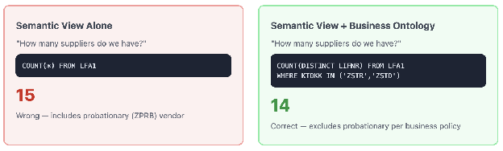
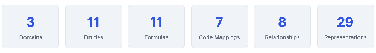
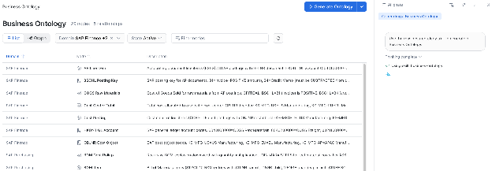
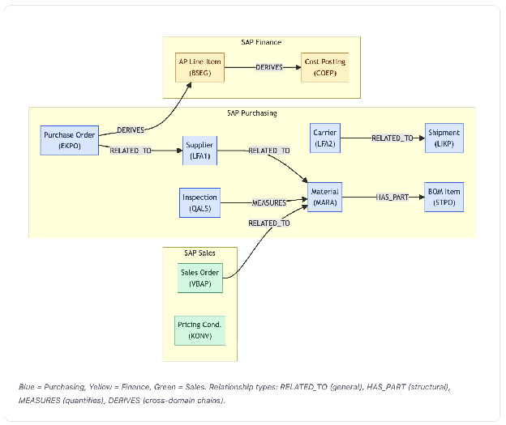
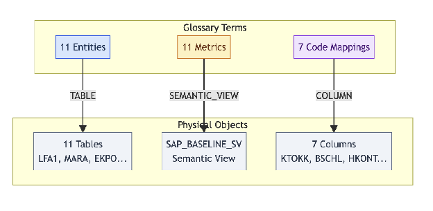
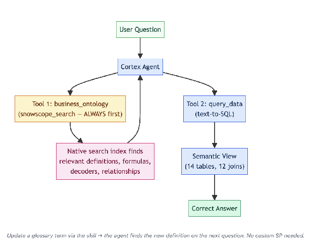
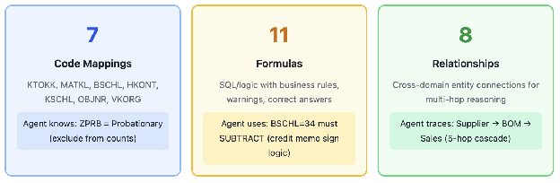
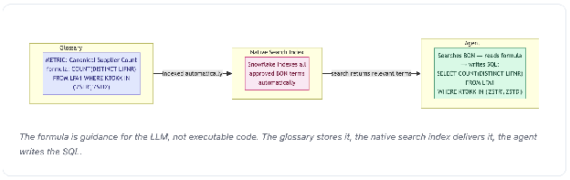
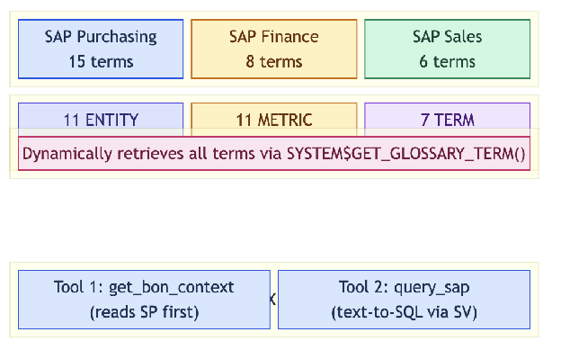
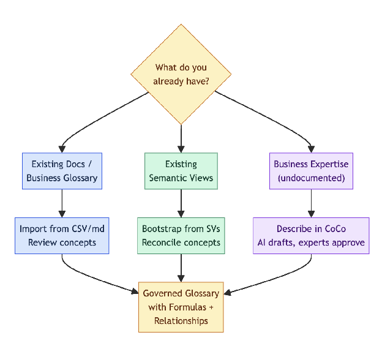

author: Tianxia Jia
id: getting-started-with-business-ontology
categories: snowflake-site:taxonomy/solution-center/certification/quickstart, snowflake-site:taxonomy/product/ai, snowflake-site:taxonomy/product/platform
language: en
summary: Build a governed Business Ontology of domains, entities, metrics, code-mapping terms, and relationships, then surface it to a Cortex Agent alongside a Semantic View.
environments: web
status: Published
feedback link: https://github.com/Snowflake-Labs/sfquickstarts/issues
fork repo link: https://github.com/sfc-gh-cnantasenamat/getting-started-with-business-ontology

# Getting Started with Business Ontology

## Overview

> **Private Preview:** Business Ontology must be enabled on your Snowflake account before use. Contact your Snowflake account team or SE.

Business Ontology is Snowflake's governed vocabulary layer. It lets you define what business concepts mean (metrics, entities, code-mapping terms, formulas) and how they relate to each other. Once defined, Cortex Agents use this knowledge to answer questions that require understanding beyond raw table schemas.

**The core problem it solves:** A Semantic View teaches an agent *how to query* (tables, columns, joins). Business Ontology teaches it *what the answer means* (which vendors count as "canonical", how to handle credit memos, what formula to use for COGS).



In this guide you model an SAP-style supply chain across Purchasing, Finance, and Sales, then connect that ontology to a Cortex Agent.

### What You'll Learn
- How to create Business Ontology domains, entity nodes, metric nodes, and code-mapping terms
- How to encode business rules such as exclusions and sign logic in metric formulas
- How to define relationships between concepts across domains
- How to bind ontology terms to physical Snowflake objects with representations
- How to create a Cortex Agent that searches Business Ontology before querying data
- How to bootstrap an ontology from documents, Semantic Views, dbt, or conversation

### What You'll Build



| Object | Count | Purpose |
| :---- | :---- | :---- |
| **Domains** | 3 | Group concepts by business area |
| **Entity nodes** | 11 | Business objects (Supplier, Material, PO, etc.) |
| **Metric nodes** | 11 | Formulas with business rules (COGS, OTD, Risk, etc.) |
| **Code-mapping terms** | 7 | SAP field code mappings (MATKL, BSCHL, HKONT, etc.), `itemKind: TERM` |
| **Relationships** | 8 | Cross-domain connections (Supplier→Material, PO→AP, etc.) |
| **Representations** | 29 | Bind terms to physical Snowflake objects (optional for agent, recommended for governance) |
| **Cortex Agent** | 1 | Uses native BON search + Semantic View to answer questions |

### What You'll Need
- Access to a [Snowflake account](https://signup.snowflake.com/?utm_source=snowflake-devrel&utm_medium=developer-guides&utm_cta=developer-guides) with the Business Ontology feature enabled (Private Preview)
- Snowsight access to **Catalog > Business Ontology**
- The ACCOUNTADMIN role, or a role that can create a database, schema, warehouse, and agent
- A clone or download of the [companion repository](https://github.com/sfc-gh-cnantasenamat/getting-started-with-business-ontology), which contains the SAP sample data and setup scripts in `sql/`
- Optional: Cortex Code (CoCo) Desktop or CLI for bulk import, AI extraction, and advanced skill workflows

## Setup

### Load the Sample SAP Data

The phases below describe an SAP-style dataset in `DB_ONTOLOGY_CONTROL_PLANE.SAP_PRODUCTION`. Create it by running these scripts from the companion repository's `sql/` folder, in order, in a Snowsight SQL worksheet:

| Script | Creates |
| :---- | :---- |
| `01_setup_database.sql` | Database `DB_ONTOLOGY_CONTROL_PLANE`, schema `SAP_PRODUCTION`, and warehouse `ONTOLOGY_WH` |
| `02_create_sap_tables.sql` | 15 SAP tables with 266 rows across purchasing, finance, and sales |
| `03_create_semantic_view.sql` | `SAP_BASELINE_SV`, covering 14 of the 15 tables (all except `QUAL_MATRIX`) with 12 relationships |

Script `04_create_agents.sql` creates the agents used later in Create the Agent. Run it after you build the ontology. Script `05_create_bon_glossary.sql` is a SQL alternative to Phases 1 to 5 below.

Check the load before you continue:

```sql
SELECT COUNT(*) AS all_vendors,
       COUNT_IF(KTOKK IN ('ZSTR','ZSTD')) AS canonical_suppliers
FROM DB_ONTOLOGY_CONTROL_PLANE.SAP_PRODUCTION.LFA1;
```

You should see 15 vendors, of which 14 are canonical suppliers.

### Get Started in Snowsight

In Snowsight, go to **Catalog > Business Ontology (Preview)**. Click **Generate Ontology** to create your first domain and start adding terms interactively.



### Install the CoCo Skill (Optional)

For bulk import, AI-assisted extraction from files, Semantic Views, and dbt, and for conversational authoring, install the `$business-ontology` CoCo skill:

```
/find-skill business-ontology
```

If it is not available in the catalog, obtain the folder from your Snowflake account team and copy it to `~/.snowflake/cortex/skills/business-ontology/`.

## Build the Ontology


### Phase 1: Create Domains

Domains group related business concepts. Use one domain per business area.

Open CoCo and type this prompt. The `$business-ontology` prefix ensures the skill is invoked:

```
$business-ontology Create three domains: SAP Purchasing, SAP Finance, SAP Sales
```

> **What happens behind the scenes:** The skill calls `SYSTEM$CREATE_GLOSSARY_DOMAIN()` for each domain. No draft or approve step is needed for domains; they are created immediately.

### Phase 2: Add Entity Nodes

Entities are business objects: things that exist and can be counted or listed. They have descriptions but no formulas. Give the skill the entity name, domain, and a description that includes key field mappings.

```
$business-ontology Add the following entities:

SAP Purchasing domain:
1. Supplier: Vendor master (LFA1). 15 vendors with LIFNR vendor number.
   KTOKK account group: ZSTR=Strategic, ZSTD=Standard, ZPRB=Probationary.
   Exclude ZPRB from canonical counts.
2. Material: Material master (MARA). MATKL material group codes:
   043=Electronics, 044=Chemicals, 045=Metals, 046=Packaging, 047=Raw Materials.
   STPRS is standard price in USD.
3. Purchase Order: Purchasing document item (EKPO). STATU status codes:
   O=Open, C=Closed, R=Received. NETWR=net value USD, MENGE=quantity.
4. Shipment: Delivery/shipment (LIKP). Compare WADAT (actual delivery) vs
   LFDAT (expected delivery) for operational OTD. Do NOT use LFA2.OTRAT
   which is carrier self-reported and unreliable.
5. Carrier: Forwarding agent (LFA2). VSART shipping type:
   01=Ocean, 02=FTL, 03=Air, 04=Intermodal, 05=LTL.
   OTRAT is self-reported OTD; unreliable, do not use for real OTD calculation.
6. Inspection: Quality inspection lot (QALS). VCODE result:
   A=Accepted, R=Rejected, C=Conditional. QAESSION = defect rate percentage.
7. BOM Item: Bill of Materials component (STPO). STLNR=parent assembly,
   IDNRK=child component, MENGE=quantity per assembly.
   4-level recursive hierarchy enables cost rollup.

SAP Finance domain:
8. AP Line Item: Accounting document line (BSEG). BSCHL posting key:
   31=Invoice (positive, add to totals), 34=Credit memo (negative, SUBTRACT).
   HKONT=GL account. DMBTR=amount in local currency.
9. Cost Posting: Cost element posting (COEP). OBJNR cost object codes:
   KS-MFG-US=US Manufacturing, KS-MFG-EU=EU Manufacturing,
   KS-MFG-AP=APAC Manufacturing, KS-LOG=Logistics, KS-QA=Quality.
   KSTAR=cost element, WRTBTR=amount.

SAP Sales domain:
10. Sales Order: Sales document item (VBAP). VKORG sales org:
    1000=Americas, 2000=EMEA, 3000=APAC. NETWR=net value, KWMENG=quantity.
    KUNNR=customer number.
11. Pricing Condition: Pricing condition record (KONV). KSCHL condition type:
    PR00=Base price, K007=Customer discount (REDUCES revenue, KWERT is negative),
    KF00=Freight surcharge (ADDS to revenue, KWERT is positive).
```

> **What happens:** For each entity, the skill calls `SYSTEM$DRAFT_GLOSSARY_TERM({...})` with `itemKind: "ENTITY"`, shows you the draft, then calls `SYSTEM$APPROVE_GLOSSARY_TERM(termId)` when you confirm.

### Phase 3: Add Metric Nodes

Metrics include a `formula` field. This is where you encode the business logic that a Semantic View cannot express. Give the skill the metric name, domain, formula, and a description that explains the business rule.

```
$business-ontology Add the following metrics with formulas:

SAP Purchasing domain:
1. Canonical Supplier Count
   Formula: COUNT(DISTINCT LIFNR) FROM LFA1 WHERE KTOKK IN ('ZSTR','ZSTD')
   Description: Excludes ZPRB probationary vendors per business policy. Answer is 14, not 15.

2. Operational OTD Rate
   Formula: COUNT(CASE WHEN WADAT <= LFDAT THEN 1 END) / COUNT(*) FROM LIKP WHERE STATU='D'
   Description: Real delivery on-time rate from actual vs expected dates.
   WARNING: Do NOT use LFA2.OTRAT; that is carrier self-reported (~90%) and unreliable.
   Real OTD is approximately 66.7%.

3. Total Procurement Spend
   Formula: SUM(NETWR) FROM EKPO
   Description: Use EKPO.NETWR (PO line values) only.
   NOT LFB1.JWERT; those are annual contract values which are much larger.

4. Weighted Supply Risk Score
   Formula: 0.4 * single_source_flag + 0.3 * defect_rate + 0.3 * delivery_failure_rate
   Description: Fixed business policy weights; DO NOT change.
   Highest risk material is MAT-006 at 0.70.

5. Supplier Disruption Cascade
   Formula: Recursive chain: Supplier -> EKPO(materials) -> STPO(recursive BOM upward) -> affected assemblies
   Description: Traces which assemblies are affected when a supplier is disrupted.
   Uses recursive CTE on STPO traversing upward from IDNRK to STLNR.
   This is a 5-hop cross-domain traversal from supplier to revenue impact.

6. BOM Cost Rollup
   Formula: Recursive CTE on STPO downward (STLNR->IDNRK), multiply MENGE at each level, JOIN MARA.STPRS for leaf node costs
   Description: True material cost via recursive BOM explosion.
   For ASSY-004: $286.60/unit. Do NOT use the assembly STPRS ($520); that includes overhead markup.

SAP Finance domain:
7. COGS Raw Materials
   Formula: SUM(CASE WHEN BSCHL='31' THEN DMBTR WHEN BSCHL='34' THEN -DMBTR END) FROM BSEG WHERE HKONT='0040100000'
   Description: CRITICAL: BSCHL=31 (invoice) is POSITIVE. BSCHL=34 (credit memo) must be SUBTRACTED.
   Credit memos represent quality returns and adjustments. Ignoring them overstates COGS.
   Correct answer: $1,290,020. Wrong answer without sign logic: $1,353,690 or $1,417,360.

8. Product Gross Margin
   Formula: VBAP.NETWR - (BOM_Cost_Rollup * VBAP.KWMENG)
   Description: Cross-domain formula spanning Sales -> Purchasing -> Finance.
   Revenue from VBAP minus material COGS from recursive BOM cost rollup times units sold.
   No direct FK connects VBAP to BSEG; the chain goes through BOM.

9. Cost Center Total
   Formula: SUM(WRTBTR) FROM COEP WHERE OBJNR = cost_object_code
   Description: Total cost allocated to a specific cost center.
   OBJNR code mapping: KS-MFG-US=US Manufacturing ($419,750), KS-MFG-EU=EU Manufacturing,
   KS-MFG-AP=APAC Manufacturing, KS-LOG=Logistics, KS-QA=Quality Assurance.

SAP Sales domain:
10. Discount Leakage
    Formula: SUM(ABS(KWERT)) FROM KONV WHERE KSCHL='K007'
    Description: Customer discounts only (K007). KWERT values are NEGATIVE for discounts.
    EXCLUDE KF00 (freight surcharges); those ADD to revenue, not reduce it.
    EXCLUDE PR00 (base prices); those are not discounts.

11. Disruption Revenue Impact
    Formula: Sum of VBAP.NETWR for all assemblies identified by Supplier Disruption Cascade
    Description: Revenue at risk from supplier disruption. Uses the Disruption Cascade
    output (affected assemblies) then looks up their sales revenue in VBAP.
```

> **What happens:** For each metric, the skill calls `SYSTEM$DRAFT_GLOSSARY_TERM({...})` with `itemKind: "METRIC"` and the `formula` field populated. The formula is stored as metadata on the term. The skill shows you the draft, then approves when you confirm.

### Phase 4: Add Code-Mapping Terms

Code-mapping terms capture the meaning of cryptic ERP field codes. They use `itemKind: "TERM"` (the same kind as any general business concept) and have no formula. Their descriptions contain the code-to-meaning mappings the agent needs.

```
$business-ontology Add the following code-mapping terms:

SAP Purchasing domain:
1. MATKL Material Group: SAP material group codes:
   043=Electronics, 044=Chemicals, 045=Metals, 046=Packaging, 047=Raw Materials, 048=Assembly
2. KTOKK Account Group: SAP vendor account groups:
   ZSTR=Strategic partner, ZSTD=Standard vendor, ZPRB=Probationary (exclude from active counts)

SAP Finance domain:
3. BSCHL Posting Key: SAP posting keys:
   31=Vendor invoice (positive, add to totals), 34=Credit memo (negative, SUBTRACT from totals)
4. HKONT GL Account: SAP GL accounts:
   0040100000=COGS Raw Materials, 0040200000=COGS Freight, 0021100000=Accounts Payable
5. OBJNR Cost Object: SAP cost objects:
   KS-MFG-US=US Manufacturing, KS-MFG-EU=EU Manufacturing, KS-MFG-AP=APAC Manufacturing,
   KS-LOG=Logistics, KS-QA=Quality Assurance

SAP Sales domain:
6. KSCHL Condition Type: SAP pricing condition types:
   PR00=Base/list price, K007=Customer discount (include in discount calculations),
   KF00=Freight surcharge (EXCLUDE from discount calculations)
7. VKORG Sales Org: SAP sales organizations:
   1000=Americas, 2000=EMEA, 3000=APAC
```

#### Scaling Code-Mapping Terms

Create one term per code field, not per code value. In this demo you inline a handful of codes per term (for example, six MATKL values). That works when the agent only needs a few business-critical codes. Real enterprises have code tables with tens of thousands or millions of values, such as large product code catalogs. The pattern for scale:

1. **BON holds the code-mapping pattern, not the full lookup.** Create one TERM per code field: *"MATKL Material Group: maps material group codes to categories. Key business-rule codes: 047=Raw Materials (used in COGS), 048=Assembly (used in BOM). Full mapping in reference table T023."* The term describes what the code means and which values matter for business rules.
2. **The reference table holds the full mapping.** The actual code and description table (for example, T023 for MATKL, T077D for material types) lives in Snowflake as a regular table. The Semantic View includes a join relationship to it. The agent joins at query time to decode any code it encounters.
3. **Sync is a data problem, not an ontology problem.** New product codes arrive through normal ETL or CDC into the reference table. The BON term only needs updating when the *business rules around codes change* (for example, a new account group that should be excluded from counts), not when new code values are added.

In short, BON governs the *meaning and rules* of a code field, and the reference table holds the *values*. The agent uses both: BON for business rules, and a join for lookups.

### Phase 5: Define Relationships

Relationships connect entities across and within domains. Tell the skill the source, target, and relationship type.



Relationship type guidance, per skill best practices:

- `RELATED_TO`: general purpose, use when no other type fits precisely (for example, Supplier → Material)
- `HAS_PART`: target is a structural component of source (Material has part BOM Item)
- `MEASURES`: source is a metric that quantifies target (Inspection measures Material)
- `DERIVES`: target is generated or computed from source (Purchase Order derives AP Line Item)
- Other supported types: `HAS_VARIANT`, `IDENTIFIED_BY`, `CLASSIFIES`, `APPLIES_TO`, `SCOPES`, `EQUIVALENT_TO`, `CUSTOM`
- Prefer specific types over `RELATED_TO` when the semantics are clear. The skill's quality gate (`R-00`) validates that only supported types are used.

You can define all eight relationships in a single prompt:

```
$business-ontology Define the following relationships:
- Supplier is related to Material
- Material has part BOM Item
- Purchase Order is related to Supplier
- Carrier is related to Shipment
- Inspection measures Material
- Purchase Order derives AP Line Item (cross-domain: Purchasing → Finance)
- AP Line Item derives Cost Posting (cross-domain: Finance)
- Sales Order is related to Material (cross-domain: Sales → Purchasing)
```

> **What happens:** For each relationship, the skill calls `SYSTEM$DRAFT_GLOSSARY_RELATIONSHIP(sourceTermId, targetTermId, relType)` using the termIds it stored from Phase 2. The draft returns a `suggestionId`, not a relationship ID. When you confirm, the skill approves it with the same three arguments: `SYSTEM$APPROVE_GLOSSARY_RELATIONSHIP(sourceTermId, targetTermId, relType)`, which returns the new `relationshipId`.
>
> **Note:** The skill tracks termIds internally. You don't need to look up or paste IDs; just use the term names. If the skill can't resolve a name, it asks you to disambiguate.

## Verify the Ontology

After all terms and relationships are created, verify by querying the glossary:

```
$business-ontology Show me all the terms in the SAP Purchasing domain
```

Verify the full graph landed correctly. Drafted relationships are invisible until approved, so always confirm through the graph. On accounts with many domains the graph output can be truncated, so filter it to your domains:

```sql
-- Count approved terms in this guide's three domains
WITH g AS (SELECT PARSE_JSON(SYSTEM$GET_GLOSSARY_GRAPH()) AS j)
SELECT t.value:domain::STRING AS domain,
       COUNT(*) AS terms
FROM g, LATERAL FLATTEN(g.j:terms) t
WHERE t.value:domain::STRING IN ('SAP Purchasing', 'SAP Finance', 'SAP Sales')
GROUP BY 1;
```

Check that the counts match expectations: 15 terms in SAP Purchasing, 8 in SAP Finance, and 6 in SAP Sales, for 29 in total. If a relationship you defined is missing, it may still be in DRAFT state. Approve it with its source termId, target termId, and type:

```sql
SELECT SYSTEM$APPROVE_GLOSSARY_RELATIONSHIP('<sourceTermId>', '<targetTermId>', 'HAS_PART');
```

> **Avoid `SYSTEM$APPROVE_ALL_GLOSSARY_RELATIONSHIPS()` on shared accounts.** It takes no domain argument, so it is not limited to the relationships from this guide.

Spot-check a specific metric term to verify its formula:

```sql
SELECT
  PARSE_JSON(SYSTEM$GET_GLOSSARY_TERM('<termId>')):"name"::STRING as name,
  PARSE_JSON(SYSTEM$GET_GLOSSARY_TERM('<termId>')):"itemKind"::STRING as kind,
  PARSE_JSON(SYSTEM$GET_GLOSSARY_TERM('<termId>')):"formula"::STRING as formula,
  PARSE_JSON(SYSTEM$GET_GLOSSARY_TERM('<termId>')):"description"::STRING as description;
```

Expected result for a metric term:

| name | kind | formula | description |
| :---- | :---- | :---- | :---- |
| COGS Raw Materials | METRIC | SUM(CASE WHEN BSCHL='31' THEN DMBTR...) | Credit memos subtract... |

## Bind Terms to Objects

Representations link glossary terms to the Snowflake objects they describe. They are **optional for agent behavior** but **required for production governance**: catalog discoverability, lineage tracing, impact analysis, and coverage tracking.



> **Terminology:** The product calls these "representations." The underlying API uses `ASSOCIATION` / `ASSET`.

### Entities to Tables

Use one prompt for all 11 entities:

```
$business-ontology Associate all entities with their source tables:
- SAP Purchasing: Supplier → LFA1, Material → MARA, Purchase Order → EKPO,
  Shipment → LIKP, Carrier → LFA2, Inspection → QALS, BOM Item → STPO
- SAP Finance: AP Line Item → BSEG, Cost Posting → COEP
- SAP Sales: Sales Order → VBAP, Pricing Condition → KONV
All tables are in DB_ONTOLOGY_CONTROL_PLANE.SAP_PRODUCTION
```

### Metrics to Semantic View

Use one prompt for all 11 metrics:

```
$business-ontology Associate all metrics with semantic view
DB_ONTOLOGY_CONTROL_PLANE.SAP_PRODUCTION.SAP_BASELINE_SV:
- SAP Purchasing: Canonical Supplier Count, Operational OTD Rate,
  Total Procurement Spend, Weighted Supply Risk Score,
  Supplier Disruption Cascade, BOM Cost Rollup
- SAP Finance: COGS Raw Materials, Product Gross Margin, Cost Center Total
- SAP Sales: Discount Leakage, Disruption Revenue Impact
```

### Code-Mapping Terms to Columns

Use one prompt for all seven code-mapping terms:

```
$business-ontology Associate all code-mapping terms with their source columns:
- SAP Purchasing: KTOKK Account Group → column KTOKK in LFA1,
  MATKL Material Group → column MATKL in MARA
- SAP Finance: BSCHL Posting Key → column BSCHL in BSEG,
  HKONT GL Account → column HKONT in BSEG,
  OBJNR Cost Object → column OBJNR in COEP
- SAP Sales: KSCHL Condition Type → column KSCHL in KONV,
  VKORG Sales Org → column VKORG in VBAP
All tables are in DB_ONTOLOGY_CONTROL_PLANE.SAP_PRODUCTION
```

> **What happens:** The skill calls `SYSTEM$CREATE_GLOSSARY_ASSOCIATION()` for each term, linking it to the physical object. Entities bind with the `RELATED_TABLE` role, metrics with `RELATED_SEMANTIC_VIEW`, and code-mapping terms with `RELATED_TABLE` (column refType).

### Representations in SQL

Without the skill, call `SYSTEM$CREATE_GLOSSARY_ASSOCIATION` directly. The first argument is the domain-qualified term name, the second is a JSON reference to the object, and the third is the role. One example of each kind:

```sql
-- Entity -> table
SELECT SYSTEM$CREATE_GLOSSARY_ASSOCIATION('SAP Purchasing.Supplier',
  '{"refType":"TABLE","fqn":"DB_ONTOLOGY_CONTROL_PLANE.SAP_PRODUCTION.LFA1","objectName":"LFA1"}',
  'RELATED_TABLE');

-- Metric -> Semantic View
SELECT SYSTEM$CREATE_GLOSSARY_ASSOCIATION('SAP Finance.COGS Raw Materials',
  '{"refType":"SEMANTIC_VIEW","fqn":"DB_ONTOLOGY_CONTROL_PLANE.SAP_PRODUCTION.SAP_BASELINE_SV","objectName":"SAP_BASELINE_SV"}',
  'RELATED_SEMANTIC_VIEW');

-- Code-mapping term -> column
SELECT SYSTEM$CREATE_GLOSSARY_ASSOCIATION('SAP Finance.BSCHL Posting Key',
  '{"refType":"COLUMN","fqn":"DB_ONTOLOGY_CONTROL_PLANE.SAP_PRODUCTION.BSEG","dimensionName":"BSCHL"}',
  'RELATED_TABLE');
```

Each call returns `"state":"APPROVED"` when the representation is created.

### With and Without Representations

| Capability | Without | With |
| :---- | :---- | :---- |
| Agent answers questions | Works | Same, no change |
| Catalog shows term → table link | No | Yes |
| Lineage traces concept → object | No | Yes |
| "Which tables are governed?" | Can't answer | 11/15 tables linked |
| "If I drop LFA1, what concepts break?" | Can't answer | Supplier, Carrier, KTOKK Account group |

## Create the Agent

The glossary is the single source of truth. Snowflake's native `snowscope_search` tool searches the glossary index directly, with no custom stored procedure needed. Update a term in the glossary and the agent finds the new definition on the next question.

### How It Works



### Step A: Confirm Your Ontology Is Searchable

Before creating the agent, verify that your approved terms are indexed. In a CoCo terminal:

```sh
cortex search object "supplier count metric" --types=business-ontology
```

Check that the results include your domain-qualified names, kinds, definitions, and formulas. If no results appear, check that your terms are approved (not draft), your role has domain access, and the search index is current.

> **Allow time for indexing.** Newly approved terms, edits, and grant changes reach the search index at its next refresh, which can take up to 6 hours. Until then the agent reports that it found no governed definition. Approved terms are visible in Snowsight and through `SYSTEM$GET_GLOSSARY_TERM` immediately.

Search returns only terms in domains that the calling role can read. If other roles will use the agent, grant them access to each domain:

```sql
GRANT READ ON ONTOLOGY DOMAIN "SAP Purchasing" TO ROLE <role_name>;
```

### Step B: Review the Semantic View

The Semantic View defines the queryable surface: tables, columns, and joins. You created `SAP_BASELINE_SV` during Setup with `03_create_semantic_view.sql`. An abbreviated excerpt of that script shows its shape:

```sql
CREATE OR REPLACE SEMANTIC VIEW SAP_BASELINE_SV
  TABLES (
    DB_ONTOLOGY_CONTROL_PLANE.SAP_PRODUCTION.LFA1 PRIMARY KEY (LIFNR) COMMENT = 'Vendor master data',
    DB_ONTOLOGY_CONTROL_PLANE.SAP_PRODUCTION.MARA PRIMARY KEY (MATNR) COMMENT = 'Material master data',
    DB_ONTOLOGY_CONTROL_PLANE.SAP_PRODUCTION.EKPO PRIMARY KEY (EBELN, EBELP) COMMENT = 'Purchasing document items'
    -- 11 more tables in the full script
  )
  RELATIONSHIPS (
    EKPO_TO_LFA1 AS EKPO(LIFNR) REFERENCES LFA1(LIFNR),
    EKPO_TO_MARA AS EKPO(MATNR) REFERENCES MARA(MATNR)
    -- 10 more relationships in the full script
  )
  FACTS (
    EKPO.NETWR AS NETWR COMMENT = 'Net order value'
  )
  DIMENSIONS (
    LFA1.KTOKK AS KTOKK COMMENT = 'Account group'
  )
  COMMENT = 'SAP production data covering procurement, logistics, finance, and sales';
```

The Semantic View alone has no notion of which vendors are canonical or how credit memos change COGS. The agent gets that knowledge from Business Ontology.

### Step C: Create the BON Agent

The agent has **two tools**: a native BON search tool for business definitions and a Semantic View for data queries. The `experimental.EnableSnowscopeBusinessOntologySearch` flag enables the BON search corpus.

Set your context first so the agent is created next to the data. The companion repository's `04_create_agents.sql` creates an equivalent agent, `BON_SV_NATIVE_AGENT`, plus a Semantic View only `SAP_BASELINE_AGENT` you can compare it with.

```sql
USE SCHEMA DB_ONTOLOGY_CONTROL_PLANE.SAP_PRODUCTION;
USE WAREHOUSE ONTOLOGY_WH;
```

```sql
CREATE OR REPLACE AGENT MY_BON_AGENT
  COMMENT = 'Agent with native Business Ontology search + Semantic View data queries'
  PROFILE = '{"display_name": "BON Assistant"}'
  FROM SPECIFICATION
  $$
  models:
    orchestration: auto

  experimental:
    EnableSnowscopeBusinessOntologySearch: true

  orchestration:
    budget:
      seconds: 90
      tokens: 24000

  instructions:
    response: |
      You are an enterprise analytics assistant with access to governed
      business definitions from Business Ontology. When answering:
      - Show the governed formula from BON, then the query result from data.
      - If BON provides a formula, USE IT to guide your SQL generation.
      - Pay attention to sign logic, code mappings, and cross-domain chains.
      - Never invent a formula. If BON returns no formula, say so.
      - Always show your reasoning.
    orchestration: |
      CRITICAL WORKFLOW for every question:

      STEP 1: Call business_ontology FIRST to get governed definitions,
      formulas, and code mappings relevant to the question.

      STEP 2: Use the BON context to understand what field codes mean
      and which formula applies.

      STEP 3: Call query_data to run the actual data query, using the
      formula and code-mapping knowledge from BON.

      If the question is purely about definitions (what does X mean?),
      answer from BON alone without querying data.

      If a lookup returns nothing, retry once with a likely synonym,
      then report the miss rather than guessing.

  tools:
    - tool_spec:
        type: snowscope_search
        name: business_ontology
        description: |
          Search Business Ontology for governed business terms, metrics,
          entities, and code-mapping terms. Returns definitions, formulas, synonyms,
          and domain context. Call this FIRST before any data query.
    - tool_spec:
        type: cortex_analyst_text_to_sql
        name: query_data
        description: "Query production data."

  tool_resources:
    business_ontology:
      corpus: businessOntology
    query_data:
      semantic_view: "DB_ONTOLOGY_CONTROL_PLANE.SAP_PRODUCTION.SAP_BASELINE_SV"
      execution_environment:
        type: "warehouse"
        warehouse: "ONTOLOGY_WH"
  $$;
```

Three settings are required and not validated at create time, so a misspelling is accepted silently:

- `experimental.EnableSnowscopeBusinessOntologySearch: true`
- `tools[].tool_spec.type: snowscope_search`
- `tool_resources.business_ontology.corpus: businessOntology`

After creation, run `DESCRIBE AGENT MY_BON_AGENT` and check the `agent_spec` JSON for these values.

### Key Agent Design Decisions

| Setting | Baseline Agent | BON Agent | Why |
| :---- | :---- | :---- | :---- |
| Tools | 1 (text-to-sql) | 2 (snowscope\_search + text-to-sql) | BON needs the ontology search tool |
| BON search | No | `snowscope_search` with `businessOntology` corpus | Native integration, no custom SP needed |
| Token budget | 16,000 | 24,000 | BON search results add context tokens |
| Time budget | 60s | 90s | Two tool calls instead of one |
| Instructions | Generic | "search BON first, then query" | Must enforce "context first" pattern |

### Three Categories at Inference Time



## Update the Ontology

### Add New Terms

```
$business-ontology Add a metric called Net Revenue to SAP Sales.
Formula: SUM(KWERT) FROM KONV WHERE KSCHL IN ('PR00','KF00') + SUM(KWERT) FROM KONV WHERE KSCHL='K007'
Description: Base price + surcharges + discounts (discounts are negative).
```

### Modify Existing Terms

To update a term's description or formula, draft a new version:

```
$business-ontology Update the Canonical Supplier Count metric: change the description to:
Excludes ZPRB probationary and ZTMP temporary vendors. Answer: 12.
```

### Add More Relationships

```
$business-ontology Define a relationship: Canonical Supplier Count measures Supplier
```

```
$business-ontology Define a relationship: COGS Raw Materials derives from BOM Cost Rollup
```

### Discover Missing Relationships

```
$business-ontology Find more relationships in the SAP Finance domain
```

The skill analyzes existing nodes and suggests edges you might have missed (for example, "Cost Center Total MEASURES Cost Posting").

### Import from Existing Semantic Views

If you already have Semantic Views, the skill can bootstrap your ontology from them:

```
$business-ontology Bootstrap ontology from our semantic views
```

The skill scans your Semantic View estate, extracts business concepts from table and column names and comments, proposes nodes, and lets you review before committing.

### Import from dbt

```
$business-ontology Extract ontology from our dbt manifest at @my_stage/manifest.json
```

### Bulk Import from CSV

```
$business-ontology Import ontology terms from @my_stage/terms.csv
```

## Formulas and Architecture

### SV Metrics vs BON Formulas

| Aspect | SV Metric | BON Formula |
| :---- | :---- | :---- |
| **Scope** | Single-column aggregation | Multi-table, conditional, recursive |
| **Logic** | `SUM(NETWR)`, `AVG(STPRS)` | `CASE WHEN BSCHL='31' THEN DMBTR ELSE -DMBTR END` |
| **Cross-domain** | No (within one SV) | Yes (Sales → Purchasing → Finance) |
| **Business rules** | None | Exclusions, sign logic, policy weights |
| **Composability** | No | Yes, Gross Margin references BOM Cost Rollup |
| **Where stored** | Semantic View YAML | Glossary (SYSTEM\$ API) |
| **Who reads it** | Cortex Analyst (text-to-sql) | The LLM agent (as guidance for writing SQL) |

### How Formulas Flow



The formula is **guidance for the LLM**, not executable code. The glossary stores it, BON search delivers it, and the agent uses it to write the correct SQL.

### Architecture Summary



## Bootstrap Existing Knowledge

You don't have to start from scratch. The skill supports three entry points depending on what you already have.



### Existing Documents or Glossary

If your organization already has definitions in a spreadsheet, markdown file, wiki, or data dictionary, import them directly. The skill extracts concepts, synonyms, and proposed relationships from your source material.

```
$business-ontology Import ontology terms from @my_stage/business_glossary.csv
```

```
$business-ontology Extract glossary terms from this document: @my_stage/data_dictionary.md
```

What it does:

- Reads definitions from your file (CSV, markdown, or staged document)
- Proposes entities, metrics, and terms with descriptions
- Suggests relationships based on co-occurrence and naming patterns
- Presents everything for review, so you approve or edit before committing

**Best for:** Organizations that already maintain a data dictionary, business glossary spreadsheet, or domain knowledge wiki.

### Existing Semantic Views

If you already have Semantic Views in Snowflake, the skill can reverse-engineer business concepts from them. Table names, column comments, join patterns, and VQR descriptions all become candidate ontology nodes.

```
$business-ontology Bootstrap ontology from our semantic views
```

What it does:

- Scans your Semantic View estate (all semantic views in the account)
- Extracts business concepts from table and column names, comments, and join relationships
- Deduplicates across multiple Semantic Views (the same concept in two views becomes one node)
- Reconciles shared concepts and proposes business relationships
- Detects drift between existing glossary terms and Semantic View definitions
- Presents candidates for review, so you approve, edit, or skip

```
$business-ontology Find drift between ontology and semantic views
```

**Best for:** Teams that have already invested in Semantic Views and want to layer governed business meaning on top without re-entering definitions.

### Business Expertise (Conversational)

If your knowledge lives in people's heads rather than documents, describe the domain and let the skill draft terms with AI assistance. Domain experts review and approve; they don't need to write JSON or SQL.

```
$business-ontology I need to build an ontology for our supply chain procurement domain.
We track vendors, purchase orders, materials, and shipments.
Key metrics are supplier count (excluding probationary), on-time delivery rate,
and total procurement spend. We use SAP with coded fields like KTOKK and MATKL.
```

What it does:

- AI extracts entities, metrics, and code-mapping terms from your description
- Proposes formulas based on the business rules you describe
- Suggests relationships between concepts
- Drafts everything for domain experts to review and approve

```
$business-ontology Add more context: our COGS calculation must subtract credit memos
(BSCHL=34) from invoices (BSCHL=31). Ignoring credit memos overstates COGS by ~10%.
```

**Best for:** Greenfield projects, domain-specific knowledge that isn't documented, or teams where the business expert and the data engineer are different people.

### Choosing Your Entry Point

| You have... | Start with | Prompt |
| :---- | :---- | :---- |
| CSV/spreadsheet of definitions | Path 1: Import | `$business-ontology Import ontology terms from @stage/file.csv` |
| Semantic Views in Snowflake | Path 2: Bootstrap from SVs | `$business-ontology Bootstrap ontology from our semantic views` |
| dbt project with descriptions | Path 2 variant: Import from dbt | `$business-ontology Extract ontology from our dbt manifest at @stage/manifest.json` |
| Domain knowledge (not documented) | Path 3: Conversational | `$business-ontology I need to build an ontology for <your domain>...` |
| Cortex Sense context already built | Promote to glossary | `$business-ontology Promote our <context_name> context to the ontology` |
| Nothing yet | Phases 1 to 5 above | Follow the step-by-step prompts in this guide |

All paths converge to the same result: governed glossary terms with formulas, connected by relationships, ready to surface through a Cortex Agent.

## Reference and Troubleshooting

### CoCo Skill Prompts

| Task | Exact Prompt |
| :---- | :---- |
| Create domain | `$business-ontology Create a domain called <name>` |
| Add entity | `$business-ontology Add an entity called <name> to <domain>. Description: <text>` |
| Add metric | `$business-ontology Add a metric called <name> to <domain>. Formula: <sql>. Description: <text>` |
| Add code-mapping term | `$business-ontology Add a term called <name> to <domain>. Description: <code mappings>` |
| Add relationship | `$business-ontology Define a relationship: <source> is related to <target>` |
| Add HAS\_PART | `$business-ontology Define a relationship: <parent> has part <child>` |
| Add DERIVES | `$business-ontology Define a relationship: <derived> derives from <source>` |
| Add MEASURES | `$business-ontology Define a relationship: <metric> measures <entity>` |
| Import from SVs | `$business-ontology Bootstrap ontology from our semantic views` |
| Import from dbt | `$business-ontology Extract ontology from our dbt manifest at <path>` |
| Import from CSV | `$business-ontology Import ontology terms from <stage_path>` |
| Find relationships | `$business-ontology Find more relationships in the <domain> domain` |
| Delete domain | `$business-ontology Delete the <domain> domain` |
| Associate entity→table | `$business-ontology In the <domain> domain, associate the entity <name> with table <FQN>` |
| Associate metric→SV | `$business-ontology In the <domain> domain, associate the metric <name> with semantic view <FQN>` |
| Associate term→column | `$business-ontology In the <domain> domain, associate the term <name> with column <col> in table <FQN>` |

### API Reference

| Operation | SYSTEM\$ Call |
| :---- | :---- |
| Create domain | `SYSTEM$CREATE_GLOSSARY_DOMAIN('domain_name')` |
| Draft term | `SYSTEM$DRAFT_GLOSSARY_TERM('{"domainName":"...", "name":"...", "itemKind":"ENTITY", "description":"..."}')`, returns `termId`. Use `"itemKind":"METRIC"` with a `"formula"` field for metrics, or `"TERM"` for code-mapping terms |
| Approve term | `SYSTEM$APPROVE_GLOSSARY_TERM('<termId>')` |
| Draft relationship | `SYSTEM$DRAFT_GLOSSARY_RELATIONSHIP('<sourceTermId>', '<targetTermId>', '<relType>')`, returns a `suggestionId` |
| Approve relationship | `SYSTEM$APPROVE_GLOSSARY_RELATIONSHIP('<sourceTermId>', '<targetTermId>', '<relType>')`, returns the `relationshipId` |
| Create representation | `SYSTEM$CREATE_GLOSSARY_ASSOCIATION('<Domain>.<Term>', '<object reference JSON>', '<role>')` |
| Get term | `SYSTEM$GET_GLOSSARY_TERM('<termId>')` |

Gotchas:

- Use `itemKind`, not `termType`; the field name matters
- Only `METRIC` terms support the `formula` field
- Relationships use **positional args**, not JSON: `('sourceId', 'targetId', 'RELATED_TO')`
- Single quotes in JSON must be escaped as `''` in SQL

### Troubleshooting

| Issue | Cause | Fix |
| :---- | :---- | :---- |
| `Unknown function SYSTEM$CREATE_GLOSSARY_DOMAIN` | Feature flag not enabled | Contact your Snowflake account team |
| `Invalid identifier` in formula | Single quotes not escaped | Use `''` inside SQL strings within JSON |
| Relationship draft fails | Wrong API format | Use positional args, not JSON object |
| Agent ignores formulas | Instructions don't enforce context-first | Add STEP 1/2/3 orchestration instructions |
| Formula returns wrong number | Credit memo / exclusion logic missing | Check BON formula; it encodes sign logic |
| Agent uses OTRAT instead of computing OTD | No warning about unreliable self-reported data | Add WARNING in formula description |
| Skill can't find a term by name | Ambiguous name across domains | Use full name or specify domain |

## Clean Up

To remove the demo ontology, delete each domain you created. A domain cannot be deleted while it still contains terms, so the deletion runs as a cascade: representations first, then relationships, then terms, then the domain itself. Term deletion cannot be undone. The `$business-ontology` skill runs this cascade for you and asks for confirmation before deleting:

```
$business-ontology Delete the SAP Purchasing domain and all its contents
```

Repeat for the SAP Finance and SAP Sales domains.

If you prefer SQL, the cascade uses these functions in order:

```sql
-- 1. For each term, remove its representations (copy refType, fqn, and dimensionName from GET_GLOSSARY_TERM_ASSETS)
SELECT SYSTEM$GET_GLOSSARY_TERM_ASSETS('<termId>', '');
SELECT SYSTEM$DELETE_GLOSSARY_ASSOCIATION('<termId>', '{"refType":"TABLE","fqn":"DB_ONTOLOGY_CONTROL_PLANE.SAP_PRODUCTION.LFA1"}');

-- 2. Remove each relationship
SELECT SYSTEM$DELETE_GLOSSARY_RELATIONSHIP('<sourceTermId>', '<targetTermId>', 'RELATED_TO');

-- 3. Remove the terms by explicit ID
SELECT SYSTEM$DELETE_ALL_GLOSSARY_TERMS('["<termId1>","<termId2>"]');

-- 4. Remove the now-empty domain
SELECT SYSTEM$DELETE_GLOSSARY_DOMAIN('SAP Purchasing');
```

Then drop the agents, Semantic View, tables, and warehouse that the setup scripts created:

```sql
DROP DATABASE IF EXISTS DB_ONTOLOGY_CONTROL_PLANE;
DROP WAREHOUSE IF EXISTS ONTOLOGY_WH;
```

## Conclusion And Resources

Congratulations! You've successfully built a governed Business Ontology with domains, entities, metrics, code-mapping terms, and relationships, bound it to physical Snowflake objects, and surfaced it through a Cortex Agent that searches business definitions before it queries data.

### What You Learned
- How Business Ontology complements a Semantic View by encoding what answers mean
- How to create domains, entity nodes, metric nodes with formulas, and code-mapping terms
- How to define and approve relationships across domains
- How representations add catalog discoverability, lineage, and impact analysis
- How to configure a Cortex Agent with `snowscope_search` over the `businessOntology` corpus
- How to bootstrap an ontology from documents, Semantic Views, dbt, or conversation

### Related Resources
- [Business Ontology](https://docs.snowflake.com/en/LIMITEDACCESS/snowflake-horizon/business-ontology): Overview and concepts
- [Access Control](https://docs.snowflake.com/en/LIMITEDACCESS/snowflake-horizon/business-ontology-access-control): Domain-level permissions
- [Agent Integration](https://docs.snowflake.com/en/LIMITEDACCESS/snowflake-horizon/business-ontology-agents): Native `snowscope_search` with `businessOntology` corpus
- [Cortex Sense](https://docs.snowflake.com/LIMITEDACCESS/cortex-sense): Managed runtime that integrates BON alongside tables and semantic views
