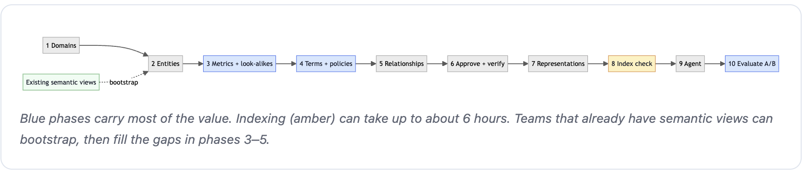
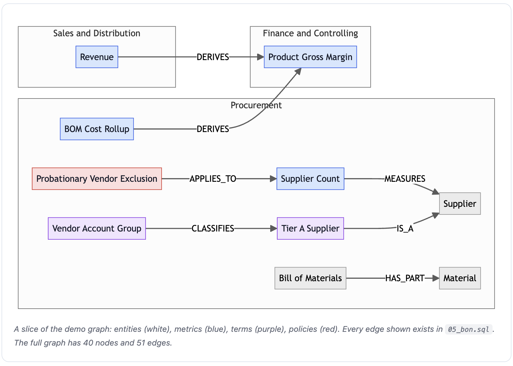
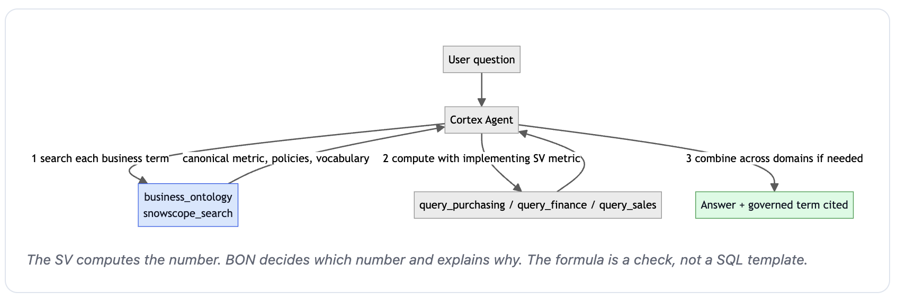

author: Tianxia Jia, Chanin Nantasenamat
id: getting-started-with-business-ontology
categories: snowflake-site:taxonomy/solution-center/certification/quickstart, snowflake-site:taxonomy/product/ai, snowflake-site:taxonomy/product/platform
language: en
summary: Build a governed Business Ontology on top of well-built semantic views, connect it to a Cortex Agent, and measure what it adds with a fair A/B test.
environments: web
status: Published
feedback link: https://github.com/Snowflake-Labs/sfquickstarts/issues
fork repo link: https://github.com/sfc-gh-cnantasenamat/getting-started-with-business-ontology

# Getting Started with Business Ontology

## Overview

> **Private Preview:** Business Ontology must be enabled on your Snowflake account. In Snowsight, check **Catalog > Business Ontology (Preview)**. Contact your Snowflake account team to enable it. Behaviour, APIs and node kinds may change before general availability.

### The Problem

Ask a simple question like "How many suppliers do we have?" and you might expect a simple answer. In most companies, though, there are several correct-looking numbers. The vendor master holds 15 vendor records, but one of them is a probationary vendor that procurement policy says doesn't count, so the official answer is 14. Both numbers are computed correctly. They just answer slightly different questions.

People resolve this kind of ambiguity from experience: they know which number Finance reports, what "Tier A supplier" means at your company, and that you never cut a material that goes into something you sell. An AI agent doesn't have that experience. Given two plausible metrics, it may pick the wrong one, hedge with "15 or 14", or give different answers to different teams. Good semantic views help a lot, but each view describes one team's data. None of them is the place to decide which of two competing definitions is the official one.

### The Solution

Business Ontology (BON) is a governed layer of business meaning that sits above your semantic views. It doesn't replace them: the semantic views still compute every number. The ontology records what each business word means, which metric is canonical and which is only a look-alike, which policies apply, and how concepts connect across domains. A domain owner approves each definition, and the agent looks it up before it queries data.

### What It Looks Like in Practice

With the ontology in place, the agent searches for "supplier count" first, finds the approved definition that says probationary vendors are excluded, queries the semantic view metric that implements it, and answers 14. It also names the definition it used, so anyone can check the answer. When the definition changes, a steward updates it once in the ontology, and every agent that consults it follows, with no edits to semantic views or prompts.

In this guide, you build exactly that on a synthetic SAP supply-chain dataset: three domain semantic views plus an ontology covering Procurement, Finance & Controlling, and Sales & Distribution. You build it in 10 steps. Each step runs one section of a companion script, shows the `$business-ontology` Cortex Code (CoCo) prompt that does the same thing, and ends with a check so you know the step worked. At the end, you compare two otherwise identical agents, one with the ontology and one without, to see what it adds.

### What You'll Learn

- What belongs in a semantic view and what belongs in Business Ontology
- How to model canonical metrics, their look-alikes, company vocabulary and policies
- How to connect ontology nodes to the semantic view metrics that implement them
- How to configure a Cortex Agent to search the ontology before it queries data
- How to measure what the ontology adds with a fair A/B test

### What You'll Build

By the end of this guide, your account holds the objects below: three domains of governed nodes, the relationships and representations that connect them to each other and to your data, and the semantic views and agents that put them to work. The counts are the same ones the **Check** lines confirm along the way.

| Object | Count | Notes |
|---|---|---|
| Domains | 3 | Procurement · Finance & Controlling · Sales & Distribution |
| Entities | 13 | Supplier, Material, Assembly, Bill of Materials, Purchase Order, Shipment, Carrier, Inspection Lot, AP Line Item, Cost Posting, Sales Order, Customer, Pricing Condition |
| Metrics | 16 | Canonical metrics, their look-alikes (e.g. *Vendor Record Count*, *Carrier Reported On-Time Rate*, *Gross Bookings*), and cross-domain metrics (*Product Gross Margin*, *Customer Profit*, *Revenue at Risk*) |
| Terms | 8 | Code fields and company vocabulary: Vendor Account Group, Material Group, Posting Key, GL Account, Cost Object, Condition Type, Sales Organization, **Tier A Supplier** |
| Policies | 3 | Probationary Vendor Exclusion, Credit Memo Sign Rule, BOM Input Protection |
| Relationships | 51 | MEASURES 13 · DERIVES 13 · CLASSIFIES 8 · RELATED_TO 6 · APPLIES_TO 4 · HAS_PART 3 · HAS_VARIANT 3 · IS_A 1 |
| Representations | 43 | IMPLEMENTS 12 · REPRESENTS 14 · RELATED_SEMANTIC_VIEW 8 · DESCRIBES 7 · REFERENCE_DATA 2 |
| Semantic views | 3 | `PURCHASING_ENRICHED_SV`, `FINANCE_ENRICHED_SV`, `SALES_ENRICHED_SV` |
| Agents | 7 | The A/B pair is `ENRICHED_AGENT` (SVs only) and `BON_AGENT` (same SVs + ontology search). The script also creates `BARE_AGENT` and two Finance/Sales team pairs used by the benchmark. |

All objects live in `DB_ONTOLOGY_CONTROL_PLANE.SAP_BON_V2`.

> **Policies:** the demo stores policies as `itemKind: POLICY_CONCEPT`. The public docs currently document only `TERM`, `METRIC` and `ENTITY`, and the other kinds are not guaranteed to be stable in preview. If you need to stay on documented kinds, model a policy as a `TERM` named "... Policy" and link it with `APPLIES_TO`.

### What You'll Need

Here's what you need before you start. Everything in the table is required except Python, which you only need for the optional full benchmark in Step 10.

| Requirement | Details |
|---|---|
| Account | Business Ontology enabled (Private Preview); search indexing enabled in your region |
| Snowsight | **Catalog > Business Ontology (Preview)**, and a SQL worksheet to run the scripts |
| Role | A role with ontology privileges. Domains use READ / SUGGEST / MODIFY / OWNERSHIP. The demo used ACCOUNTADMIN. |
| Data | The [companion repository](https://github.com/sfc-gh-cnantasenamat/getting-started-with-business-ontology), which contains the synthetic SAP data, the semantic views, the ontology, the agents and the benchmark |
| CoCo | Cortex Code Desktop or CLI, for the prompts and the search check. The `$business-ontology` skill is bundled, so no install is needed. |
| Python (optional) | Python 3.10+ and `snowflake-connector-python`, only for the full benchmark in Step 10 |
| Time | About an hour of hands-on work, plus a wait of up to about 6 hours for search indexing (Step 8) |

**Snowsight:** **Catalog > Business Ontology (Preview) > Generate Ontology** creates a domain and lets you add terms interactively. Use CoCo for bulk work, importing from semantic views, and agent setup.

Before you build anything, it helps to be clear on what Business Ontology is and how it differs from the semantic views you may already have, so that's where we start.

## What Is Business Ontology

Business Ontology is the governed meaning layer in Horizon Catalog. It models shared business meaning as a connected graph of **terms, metrics and entities**, organised into **domains**, linked by **typed relationships**, and tied to the Snowflake objects that implement them through **representations**. Only approved items are visible to agents.

**Semantic Views tell Snowflake *how* to compute a metric. Business Ontology tells everyone *what* that metric means, *which* one is canonical, *who* approved it, and *whether* teams agree.**

The table below puts the two layers side by side, using the supplier count example from the introduction.

| Layer | Owns | Example from the demo |
|---|---|---|
| Semantic View | Tables, joins, dimensions, metric SQL; executes the number | `PURCHASING_ENRICHED_SV` has both `VENDOR_RECORD_COUNT` (15) and `ACTIVE_SUPPLIER_COUNT` (14) |
| Business Ontology | Which metric is canonical, business vocabulary, policies, cross-domain links | "Supplier Count" means active suppliers; *Probationary Vendor Exclusion* applies to it; it is implemented by `ACTIVE_SUPPLIER_COUNT` |

The picture below shows the same question asked twice. On the left, the agent has only the semantic views: it sees two defensible metrics, `VENDOR_RECORD_COUNT` and `ACTIVE_SUPPLIER_COUNT`, and either picks one or hedges. On the right, the ontology tells it which metric is official and which policy applies, so it answers 14 and cites the governed term.


The SV still computes the number. BON makes the agent pick the right one and say why.

### Views Compute, Ontology Decides

Most of the decisions in this guide follow from one division of labour:

- **The semantic view is the computation authority.** The SQL that produces a number lives in the view. A formula recorded in the ontology is documentation and a cross-check, not the calculation.
- **The ontology is the meaning authority.** When two correct metrics compete for the same business word, the ontology is where you say which one is official, and why.

That's also why a good ontology definition *decides* rather than just describes. "Number of suppliers" describes. "The official supplier count used in all reporting; probationary vendors are excluded; the vendor record count is an operational variant, not the official count" decides, and that sentence is what turns an agent's "it depends" into an answer.

### What Goes Where

As a rule of thumb, anything about *how* to compute a number belongs in the semantic view, and anything about *which* definition is official, or what a word means across teams, belongs in the ontology. The table gives concrete examples of each.

| Put it in the **Semantic View** | Put it in **Business Ontology** |
|---|---|
| Table joins, dimensions, facts | Which of several metrics is the canonical one |
| Metric SQL, including filters and sign logic (`ACTIVE_SUPPLIER_COUNT`, `COGS_RAW_MATERIALS` with credit memos subtracted) | Business vocabulary the data doesn't name ("Tier A supplier", "gross bookings is not revenue") |
| Synonyms that only help text-to-SQL | Policies that constrain how metrics are used (exclusions, sign rules, what must not be cut) |
| Verified queries | Cross-domain chains (Sales → BOM → Procurement cost) and who approved each definition |

**Don't** create one ontology metric for every SV metric. Create ontology nodes where meaning is contested, company-specific or cross-domain. The SV computes; BON decides and explains.

With that mental model in place, the next section explains how the 10 build steps are laid out, so you know what to expect from each one.

## How This Guide Works

The diagram below shows the 10 build steps in order. The blue steps (metrics, terms and policies, and the A/B test) are where most of the value comes from, and the amber step is the indexing wait. If you already have semantic views, the dashed bootstrap path can stand in for the early steps.



Each of the 10 steps has the same parts:

- **Do:** the one action to take. It runs a named section of a companion script in a Snowsight SQL worksheet. Running the scripts reproduces the demo exactly: the same 40 nodes, 51 relationships and 43 representations that the benchmark results depend on.
- **With CoCo instead:** the `$business-ontology` prompt that builds the same thing through the skill. The prompts are shortened for reading. Use them to learn the workflow and to build an ontology on your own data. If you use them here, your ontology will differ from the demo and so may your results.
- **Check:** a query or command with the expected result. Don't move on until it matches.

Pick one way per step. Running both the script and the prompt drafts every node twice.

> **Keep one worksheet session.** Steps 1 to 6 approve drafts with the session-scoped form of `SYSTEM$APPROVE_ALL_GLOSSARY_TERMS`, which approves only what the current session drafted. Run them all in the same worksheet. If you switch sessions, approve by term ID instead (Step 6 shows both forms).

If you already have semantic views of your own, read **Bootstrap from Semantic Views** under **Going Further** after you finish: the import covers Step 2, and Steps 3 to 5 fill the gaps it can't infer.

Now that you know the shape of each step, you set up the demo data and the semantic views that the ontology will sit on top of.

## Set Up the Demo

**Do:** clone or download the [companion repository](https://github.com/sfc-gh-cnantasenamat/getting-started-with-business-ontology), then run these six scripts in order. The first two create the `SAP_PRODUCTION` source schema and the `ONTOLOGY_WH` warehouse. `sql/v2/01_schema_data.sql` clones those tables into `SAP_BON_V2` and stops with an error if they are missing.

```
sql/01_setup_database.sql         # database, SAP_PRODUCTION schema, warehouse
sql/02_create_sap_tables.sql      # 15 SAP tables + synthetic data
sql/v2/01_schema_data.sql         # SAP_BON_V2 schema, SAP tables and data
sql/v2/02_benchmark_ground_truth.sql  # BENCHMARK_QUESTIONS, BENCHMARK_GROUND_TRUTH (20 questions)
sql/v2/03_bare_svs.sql            # bare SVs (legacy arm; not used in the final comparison)
sql/v2/04_enriched_svs.sql        # PURCHASING / FINANCE / SALES _ENRICHED_SV
```

The remaining scripts are what Steps 1 to 10 run, section by section. Don't run them yet:

```
sql/v2/05_bon.sql                 # Steps 1 to 6: 3 domains, 40 nodes, 51 relationships
sql/v2/06_representations.sql     # Step 7: 43 representations
sql/v2/07_agents.sql              # Step 9: 7 agents
sql/v2/08_live_scenarios.sql      # optional, see Going Further
```

> **Script comments:** the header of `05_bon.sql` says 39 nodes and 49 edges, and the header of `06_representations.sql` says 44 representations. Those comments predate the final edits. The statements themselves create 40, 51 and 43, which are the numbers this guide checks.

> **Using a different database?** Every script uses `DB_ONTOLOGY_CONTROL_PLANE`. To use your own name, replace it in all SQL files before running them, then set `SNOWFLAKE_DATABASE` (and `SNOWFLAKE_SCHEMA` if you rename `SAP_BON_V2`) for the benchmark and web app:
>
> ```bash
> grep -rl DB_ONTOLOGY_CONTROL_PLANE sql | xargs sed -i.bak 's/DB_ONTOLOGY_CONTROL_PLANE/MY_DB/g'
> export SNOWFLAKE_DATABASE=MY_DB
> ```

**Check:** the three enriched semantic views exist.

```sql
SHOW SEMANTIC VIEWS IN SCHEMA DB_ONTOLOGY_CONTROL_PLANE.SAP_BON_V2;
```

Expected: `PURCHASING_ENRICHED_SV`, `FINANCE_ENRICHED_SV` and `SALES_ENRICHED_SV` (plus the bare views from `03`).

With the data and semantic views in place, you're ready to build the ontology itself, starting with the domains that hold everything else.

## 1. Create Domains

A domain groups the nodes one business area owns.

**Do:** in `sql/v2/05_bon.sql`, run the `Domains` section (the three `SYSTEM$CREATE_GLOSSARY_DOMAIN` statements).

**With CoCo instead:**

```
$business-ontology Create three domains: Procurement, Finance & Controlling, Sales & Distribution.
Describe each one's scope and its accountable business owner.
```

Underneath: `SYSTEM$CREATE_GLOSSARY_DOMAIN('Procurement')`. Domains are created immediately and don't need approval. The API can't set owners and stewards yet, so record stewardship in the domain description. Domains can't be renamed yet, so choose names carefully.

**Check:** **Catalog > Business Ontology (Preview)** lists Procurement, Finance & Controlling and Sales & Distribution.

The domains are empty containers for now. Next, you fill them with entities, the business objects that everything else connects to.

## 2. Add Entities

Entities are the business objects that metrics measure. Describe them in business language, and name the key that identifies them.

**Do:** in `05_bon.sql`, run the three node sections (`Procurement nodes`, `Finance & Controlling nodes`, `Sales & Distribution nodes`), stopping at the `Approve` comment. The script is organised by domain, so this one run drafts the entities, metrics, terms and policies for Steps 2 to 4 together: 39 drafts. Steps 3 and 4 explain the metrics, terms and policies you just drafted and have nothing extra to run.

**With CoCo instead:**

```
$business-ontology Add these entities to Procurement:
- Supplier: an active vendor we purchase from, identified by vendor number (LFA1.LIFNR).
  Vendors in a probationary account group are vendor records but not suppliers.
- Material, Assembly, Bill of Materials, Purchase Order, Shipment, Carrier, Inspection Lot
Add AP Line Item and Cost Posting to Finance & Controlling.
Add Sales Order, Customer and Pricing Condition to Sales & Distribution.
```

Underneath: `SYSTEM$DRAFT_GLOSSARY_TERM('{"name":"Supplier","domainName":"Procurement","itemKind":"ENTITY","description":"..."}')`. The skill shows each draft before it writes it.

**Check:** all 39 statements succeed, and each returns the new draft's term ID. Drafts are not yet visible to agents or in the approved term list; that changes in Step 5.

Entities give the ontology its nouns. Next come the metrics that measure them, which is where most of the conflicts the ontology resolves actually live.

## 3. Add Metrics

This is where most of the value comes from. For each metric, write down which number is canonical, and **also add the defensible-but-wrong look-alike** as its own node that says it is not the canonical one. That gives the agent something to tell apart.

**Do:** nothing new to run; Step 2 drafted all 16 metrics. Read them in `05_bon.sql` to see the pattern, for example *Supplier Count* next to *Vendor Record Count*, and *Revenue* next to *Gross Bookings*.

**With CoCo instead:**

```
$business-ontology Add these metrics to Procurement:
- Supplier Count: number of active suppliers. Canonical answer to "how many suppliers".
  Excludes probationary vendors. Formula: COUNT(DISTINCT LIFNR) WHERE account group is not probationary.
- Vendor Record Count: all vendor master records, including probationary.
  NOT the supplier count; use only when the question is explicitly about vendor records.
- On-Time Delivery Rate: share of deliveries where actual goods-issue date <= planned date (LIKP).
  Canonical OTD.
- Carrier Reported On-Time Rate: carriers' self-reported OTD (LFA2.OTRAT).
  NOT our OTD; do not use as on-time delivery.
- Procurement Spend, BOM Cost Rollup
```

The same pattern applies in the other domains:

- **Finance & Controlling:** COGS Raw Materials, COGS Freight, Cost Center Total, Product Gross Margin, Customer Profit, Break-even Discount.
- **Sales & Distribution:** Revenue (net of discounts) versus Gross Bookings (NOT revenue), Customer Discounts, Revenue at Risk.

Notes:
- `formula` is **descriptive**, not executable. The agent computes numbers with the SV metric and uses the formula to check it (see Step 9). Write it so a reviewer can see the rule: the numerator, the denominator, the filter and the grain.
- Only `METRIC` nodes carry `formula`. The formula is returned by `SYSTEM$GET_GLOSSARY_TERM`, not by graph or list reads.
- **Cross-domain metrics are the exception.** No single SV computes *Product Gross Margin* or *Revenue at Risk*. Their definitions must name each component and the bridge between domains (for example, "sold assembly → BOM components → material standard cost"), because the agent combines those components itself.

**Check:** none until approval. Step 6 reads back the *Supplier Count* formula.

Metrics settle which number is official. Terms and policies add the company vocabulary and the business rules that the data alone doesn't spell out.

## 4. Terms and Policies

**Terms** decode codes and capture company vocabulary. **Policies** are rules the agent must apply.

**Do:** nothing new to run; Step 2 drafted 7 of the 8 terms and all 3 policies. The eighth term, *Tier A Supplier*, is added at the end of Step 5, because the script adds it in its own section after the relationships.

**With CoCo instead:**

```
$business-ontology Add these terms:
Procurement:
- Vendor Account Group: KTOKK on LFA1. ZSTR=Strategic, ZSTD=Standard, ZPRB=Probationary
  (flagged EXCLUDE_FROM_ACTIVE_COUNT in reference table T077K).
- Material Group: MATKL on MARA. Full mapping in T023T.
- Tier A Supplier: our internal name for strategic suppliers, meaning vendors in account group ZSTR.
  Synonyms: tier-A, strategic supplier.
Finance & Controlling: Posting Key (31 = invoice, 34 = credit memo), GL Account, Cost Object
Sales & Distribution: Condition Type (PR00 base, K007 customer discount, KF00 freight), Sales Organization
```

```
$business-ontology Add these policies:
- Procurement / Probationary Vendor Exclusion: probationary vendors are excluded from supplier
  counts and supplier KPIs until promoted.
- Finance & Controlling / Credit Memo Sign Rule: credit memos (posting key 34) are subtracted
  from every cost and COGS total.
- Procurement / BOM Input Protection: a material used at any level of a sold assembly's BOM is a
  production input and must not be cut to reduce spend.
```

> **Scale code fields with one term per field, not one per value.** Inline only the values that business rules depend on. Keep the full code list in a reference table joined in the SV, and link the term to it with a `REFERENCE_DATA` representation. New code values arrive through ETL. The term changes only when the *rule* changes.

**Check:** none until approval (Step 6).

Every node is now drafted. Next, you approve the drafts and connect them with typed relationships, so the ontology becomes a connected graph rather than a list.

## 5. Define Relationships

Relationships connect nodes with typed edges. Use the most specific type. Direction is source → target, except `IS_A`, which runs instance or subtype → class. The table lists each type, when to use it, and an example from the demo.

| Type | Use for | Demo example |
|---|---|---|
| `MEASURES` | a metric quantifies an entity | Supplier Count MEASURES Supplier |
| `DERIVES` | the target is computed from the source | Revenue DERIVES Product Gross Margin |
| `CLASSIFIES` | a code or dimension categorises an entity | Vendor Account Group CLASSIFIES Supplier |
| `APPLIES_TO` | a policy constrains a concept | Probationary Vendor Exclusion APPLIES_TO Supplier Count |
| `HAS_PART` | a structural component | Bill of Materials HAS_PART Material |
| `HAS_VARIANT` | the same concept, scoped or narrowed | a look-alike or scoped variant of a canonical metric |
| `IS_A` | a subtype or instance | Tier A Supplier IS_A Supplier |
| `IDENTIFIED_BY`, `SCOPES`, `EQUIVALENT_TO` | keys, context boundaries, true synonyms with their own definition | Not used in the demo |
| `RELATED_TO` | only when nothing else fits | used sparingly |
| `CUSTOM` | only on explicit request, and needs a label | Not used in the demo |

**Do:** in `05_bon.sql`, three actions in this order. Relationship calls refer to nodes by name, so the nodes must be approved first.

1. Approve the 39 drafts from Step 2 (this session only):

   ```sql
   SELECT SYSTEM$APPROVE_ALL_GLOSSARY_TERMS('[]', 'ACTIVE', '{"sessionId":"CURRENT_SESSION"}');
   ```

2. Run the `Relationships` section: 49 `SYSTEM$CREATE_GLOSSARY_RELATIONSHIP` statements.
3. Run the last section, `Added for benchmark Q19`, in three parts: the *Tier A Supplier* draft, then the approve statement above again, then its two relationships. That makes 40 nodes and 51 relationships.

**With CoCo instead:**

```
$business-ontology Define these relationships (use domain-qualified names):
- Procurement.Supplier Count MEASURES Procurement.Supplier
- Procurement.Probationary Vendor Exclusion APPLIES_TO Procurement.Supplier Count
- Procurement.Vendor Account Group CLASSIFIES Procurement.Tier A Supplier
- Procurement.Tier A Supplier IS_A Procurement.Supplier
- Sales & Distribution.Revenue DERIVES Finance & Controlling.Product Gross Margin
- Procurement.BOM Cost Rollup DERIVES Finance & Controlling.Product Gross Margin
Then find more relationships I missed in each domain.
```

The graph below shows a slice of what you just created. Each box is a node, coloured by kind (entities white, metrics blue, terms purple, policies red), and each arrow is a typed relationship. Notice how *Revenue* in Sales & Distribution and *BOM Cost Rollup* in Procurement both feed *Product Gross Margin* in Finance & Controlling: those two `DERIVES` edges are the cross-domain bridge.



Underneath: `SYSTEM$CREATE_GLOSSARY_RELATIONSHIP('Procurement.Tier A Supplier','Procurement.Supplier','IS_A')`. That call writes directly. `SYSTEM$DRAFT_GLOSSARY_RELATIONSHIP(...)` followed by approval routes the edge through review. Both calls accept domain-qualified names or term IDs.

> **Important:** agent search results **do not include relationships**. The agent follows links by reading definitions. Graph edges are for governance, lineage and the catalog. Any link the agent must follow, especially a cross-domain bridge, must **also** be stated in the description text.

**Check:** all 51 relationship statements succeed. A statement that fails usually names a node that isn't approved yet, so rerun the approve statement and try again.

With nodes and relationships in place, take a moment to confirm that everything is approved and counted correctly before you connect it to data.

## 6. Approve and Verify

Drafts are invisible to agents until they are approved. If you followed Step 5, everything is already approved; this step confirms it.

**Do:** run the check below. If any counts are short, approve the remaining drafts with one of these forms:

```sql
-- Approve specific drafts, or everything from this session. Never call with no arguments:
-- an unscoped call promotes CREATE drafts account-wide.
SELECT SYSTEM$APPROVE_ALL_GLOSSARY_TERMS('["<termId1>","<termId2>"]');
SELECT SYSTEM$APPROVE_ALL_GLOSSARY_TERMS('[]', 'ACTIVE', '{"sessionId":"CURRENT_SESSION"}');
```

**With CoCo instead:**

```
$business-ontology Show all drafts I created this session and approve them.
```

**Check:** approved node counts per domain, and the formula on one metric.

```sql
SELECT 'Procurement' AS domain, ARRAY_SIZE(PARSE_JSON(SYSTEM$GET_GLOSSARY_TERM_LIST('Procurement')):terms) AS nodes
UNION ALL SELECT 'Finance & Controlling', ARRAY_SIZE(PARSE_JSON(SYSTEM$GET_GLOSSARY_TERM_LIST('Finance & Controlling')):terms)
UNION ALL SELECT 'Sales & Distribution', ARRAY_SIZE(PARSE_JSON(SYSTEM$GET_GLOSSARY_TERM_LIST('Sales & Distribution')):terms);

-- Formula is returned only by the per-term read (argument must be a constant)
SELECT PARSE_JSON(SYSTEM$GET_GLOSSARY_TERM('Procurement.Supplier Count')):formula::STRING;
```

Expected: 19, 12 and 9 nodes (40 in total), and a formula that excludes probationary vendors. To inspect edges, `SYSTEM$GET_GLOSSARY_GRAPH('Procurement')` returns the approved graph (drafts are absent; use `SYSTEM$GET_GLOSSARY_DRAFT_GRAPH()` for those). The graph for one domain also includes edges to neighbouring domains, so its counts won't add up to exactly 51.

The ontology now says what things mean. Next, you tie each node to the Snowflake object that implements it, so the agent knows where to compute each answer.

## 7. Add Representations

A representation records which Snowflake object implements a node. This is not just catalog decoration: the skill's agent builder reads approved SV representations to write each SV tool's description, and that description is how the agent chooses which view to query.

There are five representation roles, and each one links a particular kind of node to a particular kind of Snowflake object. The diagram below shows each pairing.


The table lists the same roles, with how many of each the demo creates.

| Role | From → To | Demo count |
|---|---|---|
| `IMPLEMENTS` | metric → the exact SV metric (field level) | 12 |
| `RELATED_SEMANTIC_VIEW` | cross-domain metric → each SV that supplies a component | 8 |
| `REPRESENTS` | entity → table or view | 14 |
| `DESCRIBES` | term → column | 7 |
| `REFERENCE_DATA` | term → code table (T077K, T023T) | 2 |

**Do:** run all of `sql/v2/06_representations.sql`: 43 `SYSTEM$CREATE_GLOSSARY_ASSOCIATION` statements.

**With CoCo instead:**

```
$business-ontology In Procurement, associate the metric Supplier Count with metric
ACTIVE_SUPPLIER_COUNT (logical table VENDORS) in semantic view
DB_ONTOLOGY_CONTROL_PLANE.SAP_BON_V2.PURCHASING_ENRICHED_SV as IMPLEMENTS.
Then propose representations for every other node in all three domains and show them for review.
```

Underneath:

```sql
SELECT SYSTEM$CREATE_GLOSSARY_ASSOCIATION('Procurement.On-Time Delivery Rate',
  '{"refType":"SEMANTIC_VIEW","fqn":"DB_ONTOLOGY_CONTROL_PLANE.SAP_BON_V2.PURCHASING_ENRICHED_SV",
    "subObjectType":"METRIC","entityQualifier":"SHIPMENTS","subObjectName":"OPERATIONAL_OTD_RATE"}',
  'IMPLEMENTS');
```

> In preview, representations are **not revalidated** when a semantic view is rebuilt, renamed or dropped, and there is no automatic drift detection between a definition and its implementation. After any SV change, re-check with `$business-ontology Find drift between ontology and semantic views`.

**Check:** all 43 statements succeed (19 for Procurement nodes, 14 for Finance & Controlling, 10 for Sales & Distribution). Each one reports `"validity":"VALID"` when you read it back in the `associations` array of `SYSTEM$GET_GLOSSARY_GRAPH('<domain>')`.

The ontology is complete and bound to your semantic views. Before an agent can use it, though, it has to appear in search, which is what the next step checks.

## 8. Confirm Search Indexing

Agents search an index, not the live glossary. **Indexing can take up to about 6 hours**, and deleted terms can keep appearing in results for a while after deletion.

**Do:** run these searches from a terminal with the Cortex Code CLI:

```bash
cortex search object "supplier count" --types=business-ontology
cortex search object "tier a suppliers" --types=business-ontology
```

**Check:** results show domain-qualified names such as `Procurement.Supplier Count` and `Procurement.Tier A Supplier`, with their kind and definition. If they don't, check that the terms are approved, that your role can read the domain, and that enough time has passed for indexing.

> **Stop here until both searches pass.** You can do Step 9 while you wait, because creating agents doesn't need the index. Don't ask the agents questions or run the benchmark until the searches pass; the demo harness checks the same probes with `run_benchmark.py --check-index`.

Once search can find your terms, or while you wait for it, you create the agents that put the ontology to work.

## 9. Build the Agent

The agent searches the ontology first, then queries the semantic view metric the definition points to.

The diagram below shows what happens when a question comes in. The agent first searches the ontology for each business term and gets back the canonical metric, any policies and the company vocabulary. It then computes the number with the semantic view metric that the definition names, combines results across domains when the metric spans more than one, and answers with the governed term cited.



**Do:** run all of `sql/v2/07_agents.sql`. It creates 7 agents with the same model, budget and core instructions. The two you use for the A/B comparison are:

| Arm | Agent | Tools |
|---|---|---|
| B | `ENRICHED_AGENT` | 3 enriched SVs |
| C | `BON_AGENT` | the same 3 enriched SVs + `business_ontology` search |

The other five are used only by the full benchmark: `BARE_AGENT` (arm A, bare SVs), and the consistency pairs `FINANCE_AGENT` / `FINANCE_BON_AGENT` and `SALES_AGENT` / `SALES_BON_AGENT`.

**With CoCo instead:** let the skill generate and verify the spec:

```
$business-ontology Create an agent that uses the ontology for Procurement, Finance & Controlling
and Sales & Distribution, with tools for PURCHASING_ENRICHED_SV, FINANCE_ENRICHED_SV and
SALES_ENRICHED_SV in DB_ONTOLOGY_CONTROL_PLANE.SAP_BON_V2.
```

To add the ontology to an agent you already have (the change is additive and keeps your instructions):

```
$business-ontology Add the ontology to agent DB_ONTOLOGY_CONTROL_PLANE.SAP_BON_V2.ENRICHED_AGENT
```

The core of the demo's `BON_AGENT` (full spec in `sql/v2/07_agents.sql`):

```yaml
models:
  orchestration: auto
experimental:
  EnableSnowscopeBusinessOntologySearch: true
orchestration:
  budget: {seconds: 150, tokens: 40000}
instructions:
  orchestration: |
    Before querying data, search business_ontology for each business term in the question,
    one concept per search. Use the governed definition to choose the canonical metric and to
    apply any policy. Compute numbers with the semantic view metric that implements the term;
    use the ontology formula only as a check. For cross-domain metrics, query each domain tool
    and combine the results as the definition describes.
  response: |
    State the answer first. When you used a governed definition, name the term (domain.node)
    and the semantic view metric that implements it.
tools:
  - tool_spec: {type: snowscope_search, name: business_ontology,
                description: "Governed business terms, metrics, entities and policies."}
  - tool_spec: {type: cortex_analyst_text_to_sql, name: query_purchasing, description: "..."}
  - tool_spec: {type: cortex_analyst_text_to_sql, name: query_finance,    description: "..."}
  - tool_spec: {type: cortex_analyst_text_to_sql, name: query_sales,      description: "..."}
tool_resources:
  business_ontology: {corpus: businessOntology}
  query_purchasing: {semantic_view: DB_ONTOLOGY_CONTROL_PLANE.SAP_BON_V2.PURCHASING_ENRICHED_SV, ...}
  # query_finance, query_sales likewise
```

**`CREATE AGENT` does not validate these three settings.** A typo is accepted, and the agent then silently never searches the ontology:

- `experimental.EnableSnowscopeBusinessOntologySearch: true`
- `tool_spec.type: snowscope_search`
- `tool_resources.business_ontology.corpus: businessOntology` (the resource key must equal the tool `name`)

Note the different spellings: the CLI search type is `business-ontology`, while the agent corpus is `businessOntology`.

**Check:** read the three settings back from `BON_AGENT`.

```sql
DESCRIBE AGENT DB_ONTOLOGY_CONTROL_PLANE.SAP_BON_V2.BON_AGENT;
```

Expected: the `agent_spec` column contains `EnableSnowscopeBusinessOntologySearch` set to `true`, a tool of type `snowscope_search`, and `"corpus":"businessOntology"`. With CoCo, ask: `$business-ontology Verify the ontology settings on agent BON_AGENT`.

Everything is built. The last step shows the difference the ontology makes, by asking two otherwise identical agents the same questions.

## 10. Run A/B Tests

Compare two agents that are identical except for the ontology tool: `ENRICHED_AGENT` (B) and `BON_AGENT` (C). Start with a quick hands-on comparison, then run the full benchmark if you want numbers.

### Try It

**Do:** in Snowsight, open **AI & ML > Agents**, and ask `ENRICHED_AGENT` and then `BON_AGENT` the same two questions from the benchmark. For each question, the table gives the answer the ontology makes official and the look-alike answer an agent without it may give.

| Question | Correct answer | Defensible-but-wrong answer |
|---|---|---|
| How many suppliers do we have? | 14 (active suppliers) | 15 (all vendor records, including probationary) |
| What is our revenue? | 711,915 (net of K007 discounts) | 746,000 (gross bookings) |

**Check:** `BON_AGENT` gives the correct answer and names the governed term and metric it used, for example `Procurement.Supplier Count` implemented by `ACTIVE_SUPPLIER_COUNT`. `ENRICHED_AGENT` may give the right number on some runs, but it can also pick the look-alike or hedge ("15 or 14"), and it has no governed term to cite. Because agents vary from run to run, ask each question two or three times.

### Run the Benchmark

This part is optional and needs the Python requirements in **What You'll Need**. The benchmark asks 20 questions across four tiers, with ground truth in `sql/v2/02_benchmark_ground_truth.sql`.

**Do:** from the repository root:

```bash
pip install snowflake-connector-python

# 1. Confirm the index probes pass
SNOWFLAKE_CONNECTION_NAME=<conn> python -u benchmark/run_benchmark.py --check-index

# 2. Full run: 20 questions, arms B and C, 3 runs (5 for tiers 2 and 3), plus consistency pairs
SNOWFLAKE_CONNECTION_NAME=<conn> python -u benchmark/run_benchmark.py --arms B,C --runs 3 --runs-hard 5
```

**Check:** the results usually show the gains clustered in a small number of contested questions, with controls tied. That pattern tells you the ontology is working where it should. In the demo's final run, the enriched semantic views alone scored 71/80 (89%) and the same views plus Business Ontology scored 80/80 (100%), with both tied on the control tier. The misses clustered in a few contested questions, so read the result as a gain in consistency and traceability, not as a general accuracy figure. The companion repository's README has the full scorecard.

### Design Your Own

When you evaluate an ontology on your own data, follow the same rules the demo used:

- **Questions:** write 5 to 10 per domain where meaning is contested (look-alike metrics, company vocabulary, policies, cross-domain chains). Add **controls** where the SV alone should succeed, and at least one question about a concept that doesn't exist, which the agent should decline to answer.
- **Runs:** run each question several times, because agents vary from run to run. The demo used 3 runs, and 5 for the hard tiers.
- **Scoring:** a hedged answer ("15 or 14") counts as wrong. Track accuracy, right on every run, hedging, and whether the answer cites a governed term.
- **Starting point:** adapt `benchmark/run_benchmark.py` and the ground-truth tables.

```
$business-ontology Using the approved nodes in Procurement, draft 10 evaluation questions:
4 where two plausible metrics exist, 2 using company vocabulary, 2 that need a policy,
1 control a semantic view alone should answer, and 1 about a term that doesn't exist.
For each, give the expected answer, the wrong-but-defensible answer, and the governing node.
```

That completes the core build: an approved ontology, bound to semantic views, searched by an agent and measured against a baseline. The section that follows is optional.

## Going Further

The 10 steps are complete. These sections are optional: keeping the ontology current, and starting from semantic views you already have.

### Update the Ontology

Once the ontology is live, most changes take a single prompt. The table lists common maintenance tasks and the prompt for each.

| Task | Prompt |
|---|---|
| Edit a definition or formula | `$business-ontology Update Procurement.Supplier Count: also exclude temporary vendors (ZTMP)` |
| Add a metric | `$business-ontology Add a metric Net Price Realization to Sales & Distribution. Formula: ... Description: ...` |
| Find missing edges | `$business-ontology Find more relationships in the Finance & Controlling domain` |
| Rename a node | `$business-ontology Rename Procurement.Inspection Lot to Quality Inspection` |
| Delete a domain | `$business-ontology Delete the <domain> domain` |

Edits to **ACTIVE** nodes go through an **edit card** (`SYSTEM$DRAFT_GLOSSARY_TERM_UPDATE`). The live definition stays in force until the edit is approved, and agents see the change only after the index refreshes. The skill's quality gate shows the old and new values side by side.

To practise change management on the demo, `sql/v2/08_live_scenarios.sql` contains optional scenarios that edit the ontology and show how the agents respond. For example, a steward changes the official supplier definition, and every BON-enabled agent follows without any edit to a semantic view or agent spec. Each edit must wait for the search index to refresh (up to about 6 hours) before you ask the agents again.

### Bootstrap from Semantic Views

```
$business-ontology Bootstrap ontology from our semantic views in DB_ONTOLOGY_CONTROL_PLANE.SAP_BON_V2
```

The skill scans the views (`SHOW`/`DESCRIBE`, metrics, comments, verified queries, join graph) and proposes:

- entities derived from the join graph, not one per table;
- metric and term candidates, with duplicates across views merged;
- a domain for each candidate, with its provenance shown;
- `IMPLEMENTS` representations back to the source metrics.

The diagram below shows that flow from left to right. The skill scans your views and proposes candidates, a steward reviews them, and the items the import can't infer are added by hand before everything becomes the approved ontology.


Nothing is written until you approve it at review. What the import **can't** infer is exactly where the value lies:

- which of two look-alike metrics is canonical;
- company vocabulary such as "Tier A";
- policies;
- cross-domain bridges.

Add those by hand using Steps 3 to 5.

Semantic views aren't the only starting point. Depending on where your definitions live today, you can start from any of these sources:

| You have | Prompt |
|---|---|
| CSV, spreadsheet or document on a stage | `$business-ontology Import ontology terms from @my_stage/glossary.csv` |
| dbt project | `$business-ontology Extract ontology from our dbt manifest at @my_stage/manifest.json` |
| Table and column comments | `$business-ontology Extract terms from our tables in <db.schema>` |
| Cortex Sense context | `$business-ontology Promote our <context> context to the ontology` |
| Knowledge in people's heads | `$business-ontology I need an ontology for procurement. We count suppliers excluding probationary vendors...` |
| OWL / RDF / Turtle | Use the `business-ontology-owl-dev` skill |

If any step didn't match its expected check, the table below maps common symptoms to their likely causes and fixes.

## Troubleshooting

Each row starts from what you see, then gives the most likely cause and the fix.

| Symptom | Likely cause | Fix |
|---|---|---|
| `Unknown function SYSTEM$CREATE_GLOSSARY_DOMAIN` | Feature not enabled | Contact your account team |
| A relationship statement fails | A node it names is still a draft | Approve the drafts (Step 5, action 1), then rerun the statement |
| Node counts in Step 6 are short | Drafts made in another session | Approve by term ID, or ask CoCo to show and approve your drafts |
| Agent never calls `business_ontology` | Flag, type or corpus misspelled (accepted silently) | `DESCRIBE AGENT` and check all three settings |
| Search returns nothing for new terms | Terms still in draft, or not yet indexed | Approve them, then wait up to about 6 hours and re-probe |
| Deleted or renamed terms still returned | Stale index | Wait for re-index; don't benchmark until probes are clean |
| Agent still picks the look-alike metric | No look-alike node, or the definition doesn't say "NOT ..." | Add the look-alike as its own metric that says it isn't canonical; add the policy |
| Agent can't follow a cross-domain link | The link exists only as a graph edge | Also state the bridge in the definition text, since search doesn't return edges |
| Agent picks the wrong SV tool | Tool description doesn't name the concepts | Add `IMPLEMENTS` representations and regenerate the spec, or edit the tool descriptions |
| `GET_GLOSSARY_TERM` error inside a query | The argument must be a constant | Pass a literal name or ID |
| Representation points at a rebuilt view | No revalidation in preview | Re-run the drift check after SV changes |
| `Invalid identifier` inside JSON | Unescaped single quote | Write `'` as `''` inside SQL string literals |

For day-to-day work after this guide, the quick reference below collects the calls you used in one place.

## API Quick Reference

The table lists each operation and the system function behind it.

| Operation | Call |
|---|---|
| Create domain | `SYSTEM$CREATE_GLOSSARY_DOMAIN('<name>')` |
| Draft node | `SYSTEM$DRAFT_GLOSSARY_TERM('{"name":..,"domainName":..,"itemKind":"ENTITY\|METRIC\|TERM","description":..,"formula":..,"synonyms":[..]}')` |
| Approve nodes | `SYSTEM$APPROVE_ALL_GLOSSARY_TERMS('["<id>",...]')` or `SYSTEM$APPROVE_GLOSSARY_TERM('<id or name>')` |
| Edit an active node | `SYSTEM$DRAFT_GLOSSARY_TERM_UPDATE(...)`, then approve the edit card |
| Relationship | `SYSTEM$CREATE_GLOSSARY_RELATIONSHIP('<src>','<tgt>','<TYPE>')` or `DRAFT_` + `APPROVE_` |
| Representation | `SYSTEM$CREATE_GLOSSARY_ASSOCIATION('<node>','<assetRefJson>','<ROLE>')` |
| Read | `SYSTEM$GET_GLOSSARY_TERM('<id or domain.name>')`, `SYSTEM$GET_GLOSSARY_TERM_LIST('<domain>')`, `SYSTEM$GET_GLOSSARY_GRAPH('<domain>')`, `SYSTEM$GET_GLOSSARY_DRAFT_GRAPH()` |
| Delete domain | `SYSTEM$DELETE_GLOSSARY_DOMAIN('<domain>')` |

Gotchas:
- The field is `itemKind`, not `termType`.
- Only `METRIC` nodes take `formula`.
- Relationship calls use positional arguments.
- Never call approve-all without arguments.

When you're finished exploring, clean up the demo objects. Agents search every domain the caller can see, so leftover demo terms become noise for other agents in your account.

## Clean Up

Delete the three demo domains first. A domain can't be deleted while it still contains terms, so the skill runs a cascade (representations, then relationships, then terms, then the domain) and asks for confirmation before deleting:

```
$business-ontology Delete the Procurement domain and all its contents
```

Repeat for Finance & Controlling and Sales & Distribution. Then drop the database and warehouse that the setup scripts created:

```sql
DROP DATABASE IF EXISTS DB_ONTOLOGY_CONTROL_PLANE;
DROP WAREHOUSE IF EXISTS ONTOLOGY_WH;
```

With the demo objects removed, here's a recap of what you built and where to go next.

## Conclusion And Resources

Congratulations! You've built a governed Business Ontology on top of three well-built semantic views, connected it to a Cortex Agent, and learned how to measure what it adds with a fair A/B test. The semantic views compute the numbers; the ontology decides which number is canonical and explains why.

### What You Learned

- What belongs in a semantic view and what belongs in Business Ontology
- How to model canonical metrics alongside their defensible-but-wrong look-alikes
- How terms and policies capture company vocabulary and business rules
- How representations link ontology nodes to the semantic view metrics that implement them
- How to configure a Cortex Agent with `snowscope_search` over the `businessOntology` corpus
- How to evaluate ontology uplift with controls, repeat runs and hedge-aware scoring

### Related Resources

- [Business Ontology](https://docs.snowflake.com/en/LIMITEDACCESS/snowflake-horizon/business-ontology): overview and concepts
- [Access control](https://docs.snowflake.com/en/LIMITEDACCESS/snowflake-horizon/business-ontology-access-control): domain-level privileges
- [Agent integration](https://docs.snowflake.com/en/LIMITEDACCESS/snowflake-horizon/business-ontology-agents): `snowscope_search` with the `businessOntology` corpus
- [Horizon Context](https://docs.snowflake.com/en/user-guide/snowflake-horizon/horizon-context): how Business Ontology fits with semantic views and Cortex Sense
- [Companion repository](https://github.com/sfc-gh-cnantasenamat/getting-started-with-business-ontology): build order, benchmark harness, web app and final results
